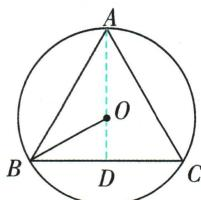
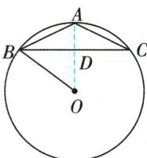

> [!success]- 必刷题
>
> > [!success] **【答案】** $4\sqrt{5}$ 或 $2\sqrt{5}$
>
> > [!note]- **【解析】**
> > 当点 O 在 $\triangle ABC$ 内部时，
> >
> > 连接 AO 并延长交 BC 于点 D，如图 (1). ∵ AB = AC, O 为 $\triangle ABC$ 的外心，∴ $AD \perp BC$ . 在 Rt $\triangle BOD$ 中，∵ BO = 5 cm, OD = 3 cm, ∴ BD = 4 cm. 在 Rt $\triangle ABD$ 中，∵ $AD = AO + OD = 5 + 3 = 8 \, (\text{cm})$ , ∴ $AB = \sqrt{BD^{2} + AD^{2}} = \sqrt{4^{2} + 8^{2}} = 4\sqrt{5} \, (\text{cm})$ . 当点 O 在 $\triangle ABC$ 外部时，连接 AO，与 BC 交于点 D，如图 (2). 由上易知 AO $\perp BC$ . 在
> >
> > ## ▶归纳总结
> >
> > 
> > 图(1)
> >
> > 已知点与圆的位置关系可以确定该点到圆心距离与半径的关系,反过来已知点到圆心距离与半径的关系可以确定该点与圆的位置关系.
> >
> > 
> > 图(2)
> >
> > Rt△BOD 中,根据勾股定理得 BD = 4 cm. 在
> >
> > 锐角三角形的外心位于三角形内, 直角三角形的外心是直角三角形斜边的中点, 钝角三角形的外心位于三角形外.
> >
> > Rt△ABD中，∵AD=AO-OD=5-3=2(cm)，∴ $AB=\sqrt{AD^{2}+BD^{2}}=\sqrt{4+16}=2\sqrt{5}$ （cm）。综上，AB的长为 $4\sqrt{5}$ cm或 $2\sqrt{5}$ cm。故答案为 $4\sqrt{5}$ 或 $2\sqrt{5}$ 。
