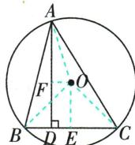

> [!success]- 必刷题
>
> > [!success] **【答案】** $2\sqrt{7} + 4
>
> > [!note]- **【解析】**
> > 如图, 连接 $OA, OB, OC$ , 过 $O$ 作 $OE \perp BC$ 于 $E, OF \perp AD$ 于 $F$ ，则 $BE = CE = \frac{1}{2} BC$ ，四边形 $OEDF$ 是矩形， $\therefore DF = OE, OF = DE. \because \angle BAC = 45^\circ, \therefore \angle BOC = 2\angle BAC = 90^\circ, \therefore$ 易知 $\triangle OBC, \triangle BOE$ 是等腰直角三角形， $\therefore OE = BE, \therefore BE = DF.$ 由勾股定理得 $OA = OB = \frac{\sqrt{2}}{2} BC.$ $\because BD = 2, DC = 6, \therefore BC = 8, \therefore BE = CE = DF = 4, OA = OB = 4\sqrt{2}, \therefore OF = DE = BE - BD = 2, \therefore$ 由勾股定理得 $AF = \sqrt{OA^2 - OF^2} = \sqrt{(4\sqrt{2})^2 - 2^2} = 2\sqrt{7}, \therefore AD = AF + DF = 2\sqrt{7} + 4.$ 故答案为 $2\sqrt{7} + 4.$
> >
> > 
