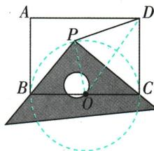

> [!success]- 必刷题
>
> > [!success] **【答案】** B
>
> > [!note]- **【解析】**
> > 【解】如图,设 BC 的中点为 O,连接 OP,OD.
> > ∵ $\angle BPC = 90^{\circ}$ , ∴ P 在以 BC 为直径的半圆 O 上运动, 当 O, P, D 在一条直线上时, PD 的值最小, 最
> >
> > 
> >
> > 小值为 $OD - OP$ 的值. $\because AB = 3, BC = 4, \therefore OC = \frac{1}{2} BC = 2 = OP, CD = AB = 3, \therefore OD = \sqrt{OC^2 + CD^2} = \sqrt{13}, \therefore PD$ 的最小值为 $\sqrt{13} - 2$ .
> >
> > ## 24.2.2 直线和圆的位置关系
