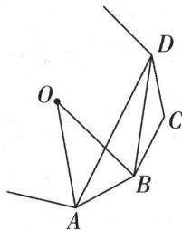
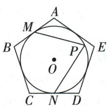

<!-- question-source:start -->
2[2024 广东汕头校级质检]如图, 点 A, B, C, D 为一个正多边形的部分顶点, 点 O 为正多边形的中心, 若 $\angle ADB = 18^{\circ}$ , 则这个正多边形的边数为
( )
A. 5    B. 10    C. 12    D. 20

(第2题图)

(第3题图)
<!-- question-source:end -->

![[Q00106948A1]]
