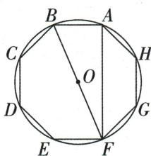
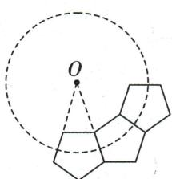

<!-- question-source:start -->
4[2025 四川成都调研]如图,正八边形 ABCDEFGH 内接于 $\odot O$ , 连接 AF, BF, 若 $S_{\triangle ABF} = 2\sqrt{2}$ , 则 $\odot O$ 的半径为 ( )
A. 1 B. $\sqrt{2}$ C. $\sqrt{3}$ D. 2

(第4题图)

(第 5 题图)
<!-- question-source:end -->

![[Q00106950A1]]
