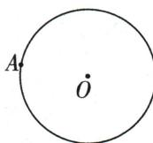

<!-- question-source:start -->
7[2025 湖北荆门质检]如图,在 $\odot O$ 中, $MF$ 为直径, $OA \perp MF$ ,圆内接正五边形 $ABCDE$ 的部分尺规作图步骤如下: ①作出半径 $OF$ 的中点 $H$ . ②以点 $H$ 为圆心, $HA$ 长为半径作圆弧,交直径 $MF$ 于点 $G$ . ③ $AG$ 长即为正五边形的边长,在 $\odot O$ 上依次作出各等分点 $B,C,D,E$ . 已知 $\odot O$ 的半径 $R=2$ ,则 $AB^{2}=$ \_\_\_\_.

<!-- question-source:end -->

![[Q00106952A1]]
