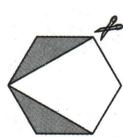
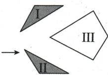

<!-- question-source:start -->
1[2025 河北石家庄期末, 中]如图, 将正六边形纸片的空白部分剪下, 得到三部分图形, 分别记为 I, II, III, 面积分别为 $S_{1}, S_{II}, S_{III}$ . 给出以下结论: ① I 和 II 合在一起能拼成一个菱形; ② III 中最大的内角是 $150^{\circ}$ ; ③ $S_{III} = 2(S_{1} + S_{II})$ . 其中正确的是 ( )

A. ①②
B. ①③
C. ②③
D. ①②③
<!-- question-source:end -->

![[Q00106953A1]]
