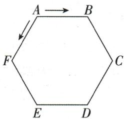
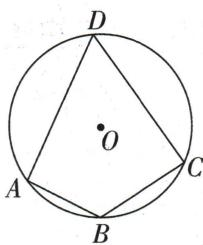

<!-- question-source:start -->
2[2024 山东烟台期中, 中]如图所示的电子装置中, 红黑两枚跳棋开始都放置在边长为 4 的正六边形 $ABCDEF$ 的顶点 $A$ 处. 跳动规则: 红跳棋按顺时针方向 1 秒跳到下 1 个顶点, 黑跳棋按逆时针方向 3 秒跳到下 1 个顶点, 经过 2022 秒后都停止跳动, 此时两枚跳棋之间的距离是 ( ) A. 8 B. $4\sqrt{3}$ C. 4 D. 0

(第2题图)

(第3题图)
<!-- question-source:end -->

![[Q00106954A1]]
