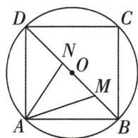

<!-- question-source:start -->
4[2024 江苏盐城校级质检, 中] 如图, 正方形 ABCD 内接于 $\odot O$ , 线段 MN 在对角线 BD 上运动, 若 $\odot O$ 的面积为 $2\pi, MN = 1$ , 则 $\triangle AMN$ 周长的最小值是 \_\_\_\_.

<!-- question-source:end -->

![[Q00106956A1]]
