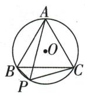
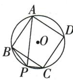

<!-- question-source:start -->
6 思想方法 数形结合 [较难] (1) 已知: 如图(1), $\triangle ABC$ 是 $\odot O$ 的内接正三角形, 点 $P$ 为劣弧 $BC$ 上一动点. 求证: $PA = PB + PC$ ; (2) 已知: 如图(2), 四边形 $ABCD$ 是 $\odot O$ 的内接正方形, 点 $P$ 为劣弧 $BC$ 上一动点. 求证: $PA = PC + \sqrt{2}PB$ .

图(1)

图(2)
<!-- question-source:end -->

![[Q00106958A1]]
