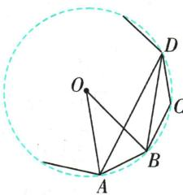

> [!success]- 必刷题
>
> > [!success] **【答案】** B
>
> > [!note]- **【解析】**
> > 如图,作正多边形的外接圆.∵ $\angle ADB = 18^{\circ}$ , ∴ $\angle AOB = 2\angle ADB = 36^{\circ}$ , ∴ 这个正多边形的边数为 $\frac{360^{\circ}}{36^{\circ}} = 10$ , 故选 B.
> >
> > 
