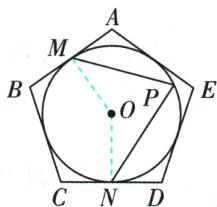

> [!success]- 必刷题
>
> > [!success] **【答案】** D
>
> > [!note]- **【解析】**
> > 如图, 连接 MO, ON. ∵ ⊙O 是正五边形 ABCDE 的内切圆, 分别切 AB, CD 于点 M, N, ∴ ∠OMB = ∠ONC = 90°.
> >
> > 
> >
> > ∵ 五边形 ABCDE 是正五边形, ∴ $\angle B = \angle C = \frac{(5 - 2) \times 180^{\circ}}{5} = 108^{\circ}$ , ∴ $\angle MON = (5 - 2) \times 180^{\circ} - 90^{\circ} - 90^{\circ} - 108^{\circ} - 108^{\circ} = 144^{\circ}$ ,
> > ∴ $\angle MPN=\frac{1}{2}\angle MON=72^{\circ}$ .
> >
> > 故选 **D**.
