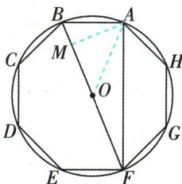

> [!success]- 必刷题
>
> > [!success] **【答案】** D
>
> > [!note]- **【解析】**
> > 连接 AO, 过点 A 作 $AM \perp OB$ 于点 M, 如图. 设 $\odot O$ 的半径为 r, 在正八边形 ABCDEFGH 中, $\angle AOB = 360^{\circ} \div 8 = 45^{\circ}$ . $\because \angle AMO = 90^{\circ}$ ,
> >
> > 
> >
> > ∴ 在 Rt $\triangle AMO$ 中， $AM^{2} + OM^{2} = OA^{2} = r^{2}$ ，
> > ∴ $AM=\frac{\sqrt{2}}{2}r.$ ∵ BF 是 $\odot O$ 的直径, ∴ BF=2r, $\angle BAF=90^{\circ},\therefore S_{\triangle ABF}=\frac{1}{2}BF\cdot AM=\frac{1}{2}\times2r\times\frac{\sqrt{2}}{2}r=2\sqrt{2}$ ，解得 r=2 或 r=-2（舍去）.
> >
> > 故选 **D**.
