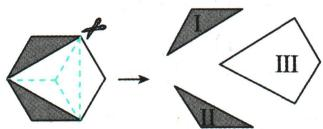

> [!success]- 必刷题
>
> > [!success] **【答案】** B
>
> > [!note]- **【解析】**
> > 如图,可以将正六边形分割成6个全等的等腰三角形,所以I、II分别相当于其中的1个等腰三角形,Ⅲ相当于由4个等腰三角形拼成,因此①I和Ⅱ合在一起能拼成一个菱形是正确的;
> > - **②**：Ⅲ中最大的内角是 $\frac{(6-2)\times180^{\circ}}{6}=120^{\circ}$ ,故②不正确;
> > - **③**：$S_{\mathrm{III}}=2(S_{1}+S_{\mathrm{II}})$ 是正确的.综上所述,正确的有①③,故选B.
> >
> > 
