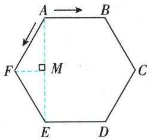

> [!success]- 必刷题
>
> > [!success] **【答案】** B
>
> > [!note]- **【解析】**
> > ∵ 红跳棋从 A 点按顺时针方向 1 秒跳到下 1 个顶点, ∴ 红跳棋每过 6 秒返回到 A 点, $2022 \div 6 = 337$ , ∴ 经过 2022 秒后, 红跳棋
> >
> > 
> >
> > 跳回到 A 点. ∵ 黑跳棋从 A 点按逆时针方向 3 秒跳到下 1 个顶点, ∴ 黑跳棋每过 18 秒返回到 A 点, $2022 \div 18 = 112 \cdots 6$ , ∴ 经过 2022 秒后, 黑跳棋跳到 E 点. 连接 AE, 过点 F 作 $FM \perp AE$ , 如图. 由题意可得, AF = EF = 4, $\angle AFE = 120^{\circ}$ , ∴ $\angle FAE = 30^{\circ}$ , ∴ $FM = \frac{1}{2}AF = 2$ . 在 Rt $\triangle AFM$ 中, $AM = \sqrt{AF^{2} - FM^{2}} = \sqrt{4^{2} - 2^{2}} = 2\sqrt{3}$ , ∴ AE = 2AM = $4\sqrt{3}$ , ∴ 经过 2022 秒后, 两枚跳棋之间的距离是 $4\sqrt{3}$ .
> >
> > 故选 **B**.
