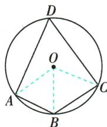

> [!success]- 必刷题
>
> > [!success] **【答案】** 48或36
>
> > [!note]- **【解析】**
> > 连接 OA, OB, OC, 如图.
> > ∵ $\angle ADC = 60^{\circ}$ , ∴ $\angle AOC = 2\angle ADC = 120^{\circ}$ . 由
> >
> > 题意得 $\angle AOB = \left(\frac{360}{m}\right)^{\circ},$ $\angle BOC = \left(\frac{360}{n}\right)^{\circ},\therefore \angle AOC =$ $\angle AOB + \angle BOC = \left(\frac{360}{m}\right)^{\circ} +$
> >
> > 
> >
> > $\left(\frac{360}{n}\right)^{\circ} = 120^{\circ}, \therefore mn = 3(m + n), \therefore m, n$ 中必有一个是3的倍数，且 $m, n$ 均为正整数。设 $m = 3k$ ( $m, k$ 均为正整数)，则 $3k \cdot n = 3(3k + n), \therefore n = \frac{3k}{k - 1}$ ( $n$ 为正整数)。当 $k = 1$ 时， $k - 1 = 0$ （不符合题意，舍去）；当 $k = 2$ 时， $n = \frac{6}{1} = 6$ ， $m = 6$ ，则 $mn = 6 \times 6 = 36$ ；当 $k = 3$ 时， $n = \frac{9}{2} = 4.5$ （不符合题意，舍去）；当 $k = 4$ 时， $n = \frac{12}{3} = 4$ ， $m = 12$ ，则 $mn = 12 \times 4 = 48$ ；当 $k = 5$ 时， $n = \frac{15}{4} = 3.75$ （不符合题意，舍去）；当 $k = 6$ 时， $n = \frac{18}{5} = 3.6$ （不符合题意，舍去）；当 $k \geqslant 7$ 时， $n$ 均不为正整数，不符合题意，舍去。综上， $mn$ 的值为48或36。故答案为48或36。
