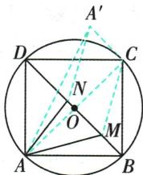

> [!success]- 必刷题
>
> > [!success] **【答案】** 4
>
> > [!note]- **【解析】**
> > 如图, 过点 $C$ 作 $CA' \parallel MN$ , 且 $CA' = MN = 1$ , 连接 $CM, A'N, AA', AC$ , $\therefore$ 四边形 $A'CMN$ 为平行四边形, $\therefore A'N = CM$ . $\because$ 四边形
> >
> > ABCD 是正方形, $\therefore AC \perp BD$ , $\angle ABC = 90^{\circ}$ , $\therefore CA' \perp AC$ , $AC$ 为 $\odot O$ 的直径, $\therefore OA = OC$ , $\therefore AM = CM = A'N$ , $\therefore \triangle AMN$ 的周长为 $AM + AN + MN = A'N + AN + 1 \geqslant$
> >
> > 
> >
> > $A^{\prime}A+1.\because\odot O$ 的面积为 $2\pi,\therefore\odot O$ 的半径为 $\sqrt{2},\therefore AC=2\sqrt{2}.$ 在 Rt $\triangle A^{\prime}AC$ 中， $A^{\prime}A=\sqrt{AC^{2}+A^{\prime}C^{2}}=\sqrt{(2\sqrt{2})^{2}+1^{2}}=3,\therefore\triangle AMN$ 周长的最小值为 $3+1=4.$
