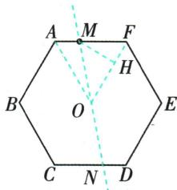

> [!success]- 必刷题
>
> > [!success] **【答案】** 详见解析
>
> > [!note]- **【解析】**
> > 【解】如图,设正六边形ABCDEF的中心为O,过点M,O作直线l交CD于点N,则直线l将正六边形的面积平分,直线l被正六边形所截的线段
> >
> > ## 关键点拨
> >
> > 
> > l
> >
> > 掌握将军饮马模型是解此类题的关键.
> >
> > 长是MN,连接OF,OA,过点M作MH⊥OF于点H.∵六边形ABCDEF是正六边形,AB=6,中心为O,∴AF=AB=6,∠AFO= $\frac{1}{2}$ ∠AFE= $\frac{1}{2}\times\frac{(6-2)\times180^{\circ}}{6}=60^{\circ}$ ,MO=ON.∵OA=OF,∴△OAF是等边三角形,∴OA=OF=AF=6.
> > ∵AM=2,∴MF=AF-AM=6-2=4.
> > ∵MH⊥OF,∴∠MHF=90°,∴∠FMH=90°-60°=30°,∴FH= $\frac{1}{2}$ MF= $\frac{1}{2}$ ×4=2,MH= $\sqrt{MF^{2}-FH^{2}}=\sqrt{4^{2}-2^{2}}=2\sqrt{3}$ ,∴OH=OF-FH=6-2=4,∴OM= $\sqrt{MH^{2}+OH^{2}}=\sqrt{(2\sqrt{3})^{2}+4^{2}}=2\sqrt{7}$ ,∴NO=OM=2 $\sqrt{7}$ ,∴MN=NO+OM=2 $\sqrt{7}$ +2 $\sqrt{7}$ =4 $\sqrt{7}$ ,即直线l被正六边形所截的线段长是4 $\sqrt{7}$ .
> >
> > 思路分析
> > 连接 OA, OC,
> > 根据三角形内角和求出∠ADC的度数,根据圆周角定理求出∠AOC的度数,再根据弧长公式计算即可得到答案.
> >
> > ## 刷素养·
> >
> > $$
> > P E = P C
> > $$
