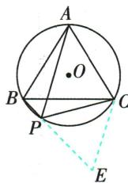
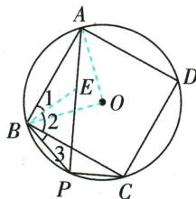

> [!success]- 必刷题
>
> > [!success] **【答案】** B
>
> > [!note]- **【解析】**
> > 【证明】(1)延长BP至E,使CE,如图(1).∵A,B,P,C四点共圆,∴∠BAC+∠BPC=180°.∵∠BPC+∠EPC=180°,△ABC是正三角形,∴∠BAC=∠CPE=60°.∵PE=PC,∴△PCE是等边三角形,∴CE=PC,∠E=60°.又
> >
> > 
> > 图(1)
> >
> > $\because \angle BCE = 60^{\circ} + \angle BCP, \angle ACP = 60^{\circ} + \angle BCP,$ $\therefore \angle BCE = \angle ACP.$ $\because \triangle ABC$ 为等边三角形， $\therefore AC = BC.$
> >
> > 在 $\triangle BEC$ 和 $\triangle APC$ 中， $\left\{\begin{aligned}CE&=PC,\\ \angle BCE&=\angle ACP,\\ BC&=AC,\end{aligned}\right.$ $\therefore \triangle BEC \cong \triangle APC (SAS), \therefore PA = BE = PB + PE = PB + PC.$ (2) 过点 B 作 $BE \perp PB$ 交 PA 于 E，连接 OA，OB，如图（2）. ∵ $\angle1 + \angle2 = \angle2 + \angle3 = 90^{\circ}$ ，
> > ∴ $\angle1 = \angle3$ . ∵ $\angle APB = \frac{1}{2} \angle AOB = 45^{\circ}$ , ∴ BP =
> >
> > $BE, \therefore PE = \sqrt{2} PB.$ 在 $\triangle ABE$ 和 $\triangle CBP$ 中， $\left\{ \begin{array}{l}BE = BP,\\ \angle 1 = \angle 3,\\ AB = BC, \end{array} \right.$ $\therefore \triangle ABE\cong \triangle CBP(SAS),$ $\therefore PC = AE,\therefore PA = AE + PE = I$
> >
> > 
> > 图(2)
> >
> > ## 24.4 弧长和扇形面积
> >
> > ## 课时1 弧长和扇形面积
