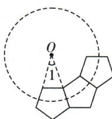

> [!success]- 必刷题
>
> > [!success] **【答案】** D
>
> > [!note]- **【解析】**
> > ∵ 正五边形的外角和为 $360^{\circ}$ ，∴ 正五边形的每一个外角为 $\frac{360^{\circ}}{5}=72^{\circ}$ 。如图， $\angle1=180^{\circ}-2\times72^{\circ}=36^{\circ}$ ，∴ 完成这一圆环排列, 共需要正五边形的个数为 $360^{\circ} \div 36^{\circ} = 10$ (个), 故选 D.
> >
> > 
