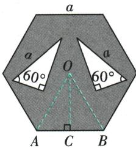

> [!success]- 必刷题
>
> > [!success] **【答案】** 5
>
> > [!note]- **【解析】**
> > 如图, 点 O 为正六边形的中心, 则 $\triangle OAB$ 是边长为 a 的等边三角形, 连接 OA, OB, 作 $OC \perp AB$ 于 C, 易知两个空白三角形面积之和为 $S_{\triangle OAB}$ , ∴ 阴影部分的面积是 $5S_{\triangle OAB}$ , ∴ $\frac{S_{\text{阴影}}}{S_{\text{空白}}} = \frac{5S_{\triangle OAB}}{S_{\triangle OAB}} = 5$ . 故答案为 5.
> >
> > 
> >
> > 根据规律分别计算出红跳棋和黑跳棋经过2022秒后的位置, 红跳棋跳回到A点, 黑跳棋跳到E点, 即可得出结论.
