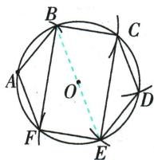

> [!success]- 必刷题
>
> > [!success] **【答案】** 详见解析
>
> > [!note]- **【解析】**
> > 【解】(1) 如图, 正六边形 ABCDEF 即为所求.
> > (2) 四边形 BCEF 为矩形.
> > 理由: 连接 BE, 如图. ∵ 六边形 ABCDEF 为正六边形,
> >
> > 
> >
> > 关键点拨
> > (1) 在 $\odot O$ 上依次截取六段弦, 使它们都等于 OA, 从而得到正六边形 ABCDEF.
> >
> > $\therefore AB = BC = CD = DE = EF = FA, \therefore \widehat{AB} = \widehat{BC} = \widehat{CD} = \widehat{DE} = \widehat{EF} = \widehat{AF}, \therefore \widehat{BC} + \widehat{CD} + \widehat{DE} = \widehat{EF} + \widehat{AF} + \widehat{AB}, \therefore \widehat{BAE} = \widehat{BCE}, \therefore BE$ 为直径， $\therefore \angle BFE = \angle BCE = 90^\circ$ ，同理可得 $\angle FBC = \angle CEF = 90^\circ$ ， $\therefore$ 四边形 $BCEF$ 为矩形.
