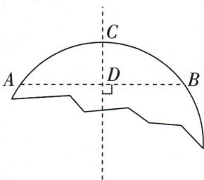
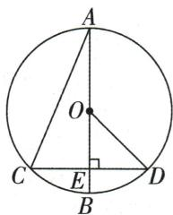

<!-- question-source:start -->
1[2024 四川凉山州中考]数学活动课上,同学们要测一个如图所示的残缺圆形工件的半径,小明的解决方案是在工件圆弧上任取两点 A, B, 连接 AB, 作 AB 的垂直平分线 CD 交 AB 于点 D, 交 $\widehat{AB}$ 于点 C, 测出 AB = 40 cm, CD = 10 cm, 则圆形工件的半径为 ( )
A. 50 cm    B. 35 cm
C. 25 cm    D. 20 cm

(第1题图)

(第2题图)
<!-- question-source:end -->

![[Q00106990A1]]
