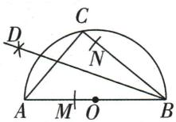
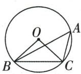

<!-- question-source:start -->
3[2024 湖北中考]如图, $AB$ 是半圆 $O$ 的直径, $C$ 为半圆 $O$ 上一点, 以点 $B$ 为圆心, 适当长为半径画弧, 交 $BA$ 于点 $M$ , 交 $BC$ 于点 $N$ , 分别以点 $M, N$ 为圆心, 大于 $\frac{1}{2} MN$ 的长为半径画弧, 两弧在 $\angle ABC$ 的内部相交于点 $D$ , 画射线 $BD$ , 连接 $AC$ . 若 $\angle CAB = 50^{\circ}$ , 则 $\angle CBD$ 的度数是 ( ) A. $30^{\circ}$ B. $25^{\circ}$ C. $20^{\circ}$ D. $15^{\circ}$

(第3题图)

(第4题图)

建议用时 40 分钟 答案 D73
<!-- question-source:end -->

![[Q00106992A1]]
