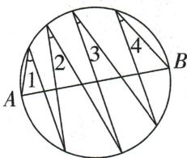

<!-- question-source:start -->
5[2024 江苏连云港中考]如图, $AB$ 是圆的直径, $\angle 1, \angle 2, \angle 3, \angle 4$ 的顶点均在 $AB$ 上方的圆弧上, $\angle 1, \angle 4$ 的一边分别经过点 $A, B$ , 则 $\angle 1 + \angle 2 + \angle 3 + \angle 4 =$ 。

<!-- question-source:end -->

![[Q00106994A1]]
