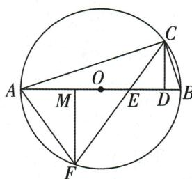

<!-- question-source:start -->
6[2024 安徽中考] 如图, $\odot O$ 是 $\triangle ABC$ 的外接圆, $D$ 是直径 $AB$ 上一点, $\angle ACD$ 的平分线交 $AB$ 于点 $E$ , 交 $\odot O$ 于另一点 $F, FA = FE$ .

(1) 求证: $CD \perp AB$ ;

(2) 设 $FM \perp AB$ , 垂足为 $M$ . 若 $OM = OE = 1$ , 求 $AC$ 的长.

<!-- question-source:end -->

![[Q00106995A1]]
