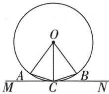

<!-- question-source:start -->
7[2024 福建中考]如图, 已知点 A, B 在 $\odot O$ 上, $\angle AOB = 72^{\circ}$ , 直线 MN 与 $\odot O$ 相切, 切点为 C, 且 C 为 $\widehat{AB}$ 的中点, 则 $\angle ACM$ 等于 ( )

A. $18^{\circ}$ B. $30^{\circ}$ C. $36^{\circ}$ D. $72^{\circ}$
<!-- question-source:end -->

![[Q00106996A1]]
