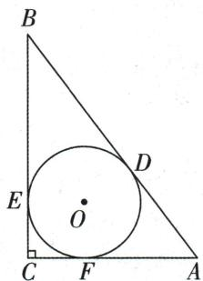
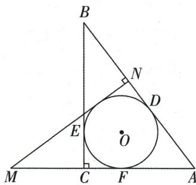

<!-- question-source:start -->
8[2024 四川自贡中考] 在 Rt $\triangle ABC$ 中, $\angle C = 90^{\circ}$ , $\odot O$ 是 $\triangle ABC$ 的内切圆, 切点分别为 D, E, F.

(1)图(1)中三组相等的线段分别是 CE = CF，
AF = \_\_\_\_, BD = \_\_\_\_；若 AC = 3, BC = 4，则⊙O半径长为\_\_\_\_；

(2)如图(2)，延长AC到点M，使AM=AB，过点M作 $MN\perp AB$ 于点N.求证：MN是 $\odot O$ 的切线.

图(1)

图(2)
<!-- question-source:end -->

![[Q00106997A1]]
