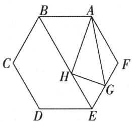
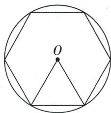

<!-- question-source:start -->
9[2024 四川绵阳中考]如图,在边长为 2 的正六边形 ABCDEF 中,连接 BE,点 H 在 BE 上运动,点 G 为 EF 的中点,当 $\triangle AGH$ 的周长最小时, $AH+GH=$ ( )

A. $2\sqrt{3}$ B. $\sqrt{13}$ C. 12 D. 13

(第9题图)

(第 10 题图)
<!-- question-source:end -->

![[Q00106998A1]]
