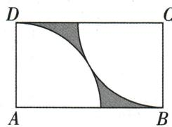
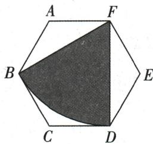

<!-- question-source:start -->
12[2024 重庆中考 A 卷]如图,在矩形 ABCD 中,分别以点 A 和 C 为圆心,AD 长为半径画弧,两弧有且仅有一个公共点.若 AD=4 ,则图中阴影部分的面积为 ( )
A. $32-8\pi$ B. $16\sqrt{3}-4\pi$ C. $32-4\pi$ D. $16\sqrt{3}-8\pi$

(第 12 题图)

(第 13 题图)
<!-- question-source:end -->

![[Q00107001A1]]
