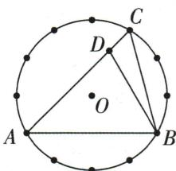
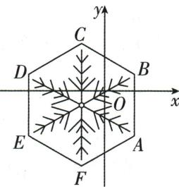

<!-- question-source:start -->
2[2025 河北邯郸质检]将 $\odot O$ 的圆周 12 等分, 点 $A, B, C$ 是等分点, 如图, $\angle ADB$ 的度数可能为 ( )
A. $30^{\circ}$ B. $45^{\circ}$ C. $60^{\circ}$ D. $65^{\circ}$

(第2题图)
(第3题图)
<!-- question-source:end -->

![[Q00107004A1]]
