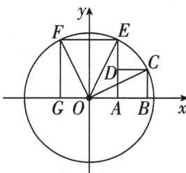

<!-- question-source:start -->
4 如图, 在平面直角坐标系中, 已知 $B(2,0)$ , 四边形 ABCD 和 AEFG 都是正方形, A, D, E 三点共线, 点 G, A, B 在 x 轴上, 点 C,

E,F 在以 O 为圆心,OC 长为半径的圆上,则 $\widehat{FC}$ 的长为
A. $\frac{\sqrt{5}}{2}\pi$ B. $\sqrt{5}\pi$ C. $\frac{5\pi}{2}$ D. $5\pi$
<!-- question-source:end -->

![[Q00107006A1]]
