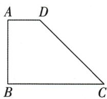
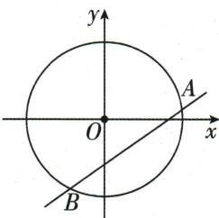

<!-- question-source:start -->
6[2024黑龙江哈尔滨期中]如图,在梯形ABCD中, $AD//BC,\angle B=90^{\circ},AD=2,AB=4,BC=6$ ,点O是边BC上一点,以O为圆心,OC长为半径的 $\odot O$ ,与边AD只有一个公共点,则OC的取值范围是()A. $4<OC\leqslant\frac{13}{3}$ B. $4\leqslant OC\leqslant\frac{13}{3}$ C. $4<OC\leqslant\frac{14}{3}$ D. $4\leqslant OC\leqslant\frac{14}{3}$

(第6题图)
(第7题图)
<!-- question-source:end -->

![[Q00107008A1]]
