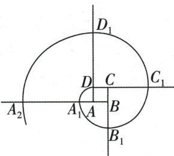
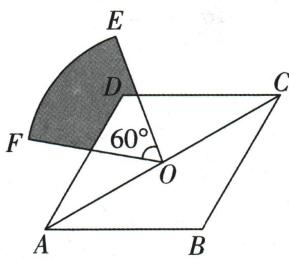

<!-- question-source:start -->
8[2023 四川达州中考]如图,四边形 ABCD 是边长为 $\frac{1}{2}$ 的正方形,曲线 $DA_{1}B_{1}C_{1}D_{1}A_{2}\cdots$ 是由多段

$90^{\circ}$ 的圆心角所对的弧组成的, 其中, $\widehat{DA_{1}}$ 的圆心为 $A$ , 半径为 $AD; \widehat{A_{1}B_{1}}$ 的圆心为 $B$ , 半径为 $BA_{1}; \widehat{B_{1}C_{1}}$ 的圆心为 $C$ , 半径为 $CB_{1}; \widehat{C_{1}D_{1}}$ 的圆心为 $D$ , 半径为 $DC_{1}; \cdots, \widehat{DA_{1}}, \widehat{A_{1}B_{1}}, \widehat{B_{1}C_{1}}, \widehat{C_{1}D_{1}}, \cdots$ 的圆心依次为 $A, B, C, D$ 循环, 则 $\widehat{A_{2023}B_{2023}}$ 的长是 ( )
A. $\frac{4045\pi}{2}$ B. $2023\pi$ C. $\frac{2023\pi}{4}$ D. $2022\pi$

(第8题图)

(第9题图)
<!-- question-source:end -->

![[Q00107010A1]]
