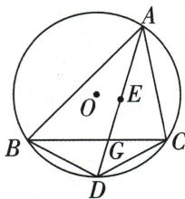

<!-- question-source:start -->
10 如图, 点 E 是 $\triangle ABC$ 的内心, AE 的延长线和 $\triangle ABC$ 的外接圆圆 O 相交于点 D, 与 BC 相交于点 G, 连接 BD, CD, 则下列结论: ① $\angle BAD = \angle CAD$ ; ② 若 $\angle BAC = 60^{\circ}$ , 则 $\angle BEC = 120^{\circ}$ ; ③ 若点 G 为 BC 的中点, 则 $\angle BGD = 90^{\circ}$ ; ④ BD = DE. 其中一定正确的个数是 ( )

A. 1 B. 2 C. 3 D. 4
<!-- question-source:end -->

![[Q00107012A1]]
