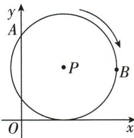

<!-- question-source:start -->
13[2024 江苏盐城校级质检]如图,在平面直角坐标系中,点 P 的坐标是(8,10), $\odot P$ 与 x 轴相切,点 A,B 在 $\odot P$ 上,它们的横坐标分别是 0,18. 若 $\odot P$ 沿着 x 轴向右作无滑动的滚动,当点 B 第一次落在 x 轴上时,点 A 的坐标是 \_\_\_\_.

<!-- question-source:end -->

![[Q00107015A1]]
