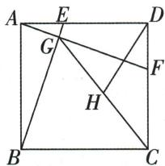

<!-- question-source:start -->
14 如图, 在边长为 2 的正方形 ABCD 中, 点 E, F 分别是边 AD, CD 上的动点, 且 AE = DF, 连接 BE, AF, 线段 BE 和 AF 相交于点 G, 连接 CG, 取 CG 的中点 H, 连接 DH, 则线段 DH 的最小值为 \_\_\_\_.

<!-- question-source:end -->

![[Q00107016A1]]
