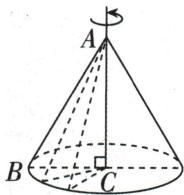
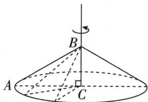

<!-- question-source:start -->
15 在数学实验课上, 小莹将含 $30^{\circ}$ 角的直角三角尺分别以两个直角边为轴旋转一周, 得到甲、乙两个圆锥, 并用作图软件 GeoGebra 画出如下示意图.

甲
乙

小亮观察后说：“甲、乙圆锥的侧面都是由三角尺的斜边 $AB$ 旋转得到的，所以它们的侧面积相等。”你认同小亮的说法吗？请说明理由.
<!-- question-source:end -->

![[Q00107017A1]]
