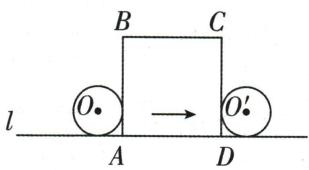
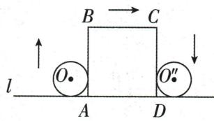

<!-- question-source:start -->
17 新考法 [2025 上海松江区期末] 如图, 在直线 l 上有一个边长为 8 cm 的正方形 ABCD 和一个直径为 4 cm 的圆 O, 圆 O 紧贴着正方形的边 AB.
(1)如图(1),正方形保持不动,圆O沿直线l以每秒 2 cm 的速度向右匀速滚动,从初始位置到圆 O 恰好离开正方形时停止滚动(即到达圆 $O'$ 的位置),在这个过程中圆 O 扫过的面积是多少?这个过程共用了多少秒?

(2) 如图(2), 圆 O 沿着正方形外侧按照 $AB \rightarrow BC \rightarrow CD$ 的方向匀速滚动, 碰到直线 l 停止滚动(即到达圆 $O''$ 的位置), 在滚动的过程中, 圆心 O 经过的路程是多少?

图(1)

图(2)
<!-- question-source:end -->

![[Q00107019A1]]
