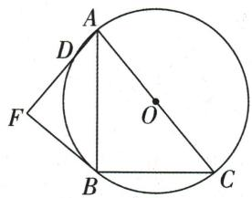
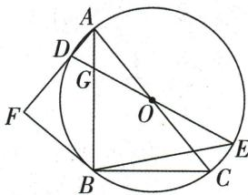

<!-- question-source:start -->
18[2025 安徽滁州定远期中]如图(1)，在 $\odot O$ 中， $AC$ 为直径， $D$ 在 $\widehat{AB}$ 上， $B$ 为 $\widehat{CD}$ 中点，连接 $AB, BC$ ，过 $B$ 作 $BF \perp AD$ 于 $F$ . (1) 求证： $BF$ 为 $\odot O$ 的切线；(2) 如图(2)，连接 $DO$ 并延长交 $AB$ 于 $G$ ，交 $\odot O$ 于 $E$ ，连接 $BE$ ，若 $AG = AD = 1$ ，求 $DF$ 的长.

图(1)

图(2)

<!-- question-source:end -->

![[Q00107020A1]]
