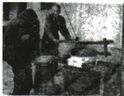
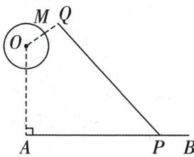

<!-- question-source:start -->
5 新考向 跨学科结合 如图(1)是传统的手工磨豆腐设备,根据它的原理设计了如图(2)的机械设

备示意图,磨盘半径 OM=20 cm,把手 MQ=15 cm,点 O,M,Q 成一直线,用长为 135 cm 的连杆将点 Q 与动力装置 P 相连( $\angle PQM$ 大小可变),点 P 在轨道 AB 上滑动并带动磨盘绕点 O 转动, $OA\perp AB$ ,OA=80 cm. 磨盘转动过程中,AP 的最大值为 ( )

图(1)

图(2)

A. $180 \mathrm{~cm}$ B. $150 \mathrm{~cm}$ C. $200 \mathrm{~cm}$ D. $(10 \sqrt{473} - 50) \mathrm{~cm}$
<!-- question-source:end -->

![[Q00107273A1]]
