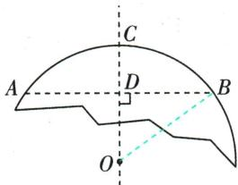

> [!success]- 必刷题
>
> > [!success] **【答案】** C
>
> > [!note]- **【解析】**
> > 易知圆心在直线 CD 上, 设圆心为 O, 连接 OB, 如图所示. ∵ CD 垂直平分 AB, AB = 40, ∴ BD = 20. ∵ CD = 10, OC = OB, ∴ OD = OB - 10. ∵ ∠ ODB = 90°, ∴ $OD^{2} + BD^{2} = OB^{2}$ , ∴ $(OB - 10)^{2} + 20^{2} = OB^{2}$ , 解得 OB = 25, 即圆形工件的半径为 25 cm. 故选 C.
> >
> > 
