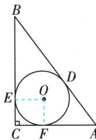
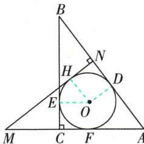

> [!success]- 必刷题
>
> > [!success] **【答案】** AD
>
> > [!note]- **【解析】**
> > (1)【解】连接 OE, OF, 如图(1).
> > 由切线长定理可知, AF = AD, BD = BE.
> > ∵ $\angle C = 90^{\circ}$ , $\odot O$ 是 $\triangle ABC$ 的内切圆, 切点分别为 D, E, F, ∴ $\angle C = \angle OEC = \angle OFC = 90^{\circ}$ , OE = OF, ∴ 四边形 OECF 是正方形.
> > 设 OE = OF = CF = CE = x，则 BE = BC - CE = 4 - x = BD，AF = AC - CF = 3 - x = AD. ∵ BD + AD = AB = $\sqrt{AC^{2} + BC^{2}} = \sqrt{3^{2} + 4^{2}} = 5$ ，∴ $4 - x + 3 - x = 5$ ，解得 x = 1，∴ OE = 1，即 $\odot O$ 半径长为 1. 故答案为 AD, BE, 1.
> >
> > 
> >
> > 
> > 图(1)
> > 图(2)
> >
> > (2)【证明】过 O 作 $OH \perp MN$ 于 H，连接 OD，OE，如图(2).
> >
> > ∵ $\angle ANM = 90^{\circ} = \angle ACB, \angle A = \angle A, AM = AB,$ ∴ $\triangle AMN \cong \triangle ABC(AAS), \therefore AN = AC.$ ∵ AD = AF, ∴ AN - AD = AC - AF，即 DN = CF.
> >
> > 由(1)可知，CF = OE, ∴ DN = OE. ∵ $\angle ANM = 90^{\circ} = \angle ODN = \angle OHN,$ 四边形 OHND 是矩形，∴ OH = DN, ∴ OH = OE，即 OH 是 $\odot O$ 的半径. 又∵ $OH \perp MN, \therefore MN$ 是 $\odot O$ 的切线.
