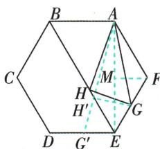

> [!success]- 必刷题
>
> > [!success] **【答案】** B
>
> > [!note]- **【解析】**
> > 若 $\triangle AGH$ 的周长最小, 则 $AH + HG$ 的值最小. 如图, 作点 G 关于 BE 的对称点 $G'$ , 由正六边形的性质和 G 为 EF 中点易得 $G'$ 为 DE 中
> >
> > 
> >
> > 点. 连接 $AG'$ 交 BE 于点 $H'$ ，连接 AE, $H'G$ ，则 $H'G = H'G'$ ，∴ $AH' + GH' = AH' + G'H' = AG'$ ，$\therefore AG'$ 的值即为 $AH + HG$ 的最小值. 过 $F$ 作 $FM \perp AE$ 于 $M$ . $\because$ 正六边形 $ABCDEF$ 边长为 $2, \therefore \angle AFE = \angle DEF = 120^\circ, AF = EF = DE = 2, \therefore \angle FAE = \angle FEA = 30^\circ, \therefore FM = 1, \angle AED = 90^\circ, \therefore AM = EM = \sqrt{3}, \therefore AE = 2\sqrt{3}$ . $\because G'$ 为 $DE$ 中点, $\therefore EG' = \frac{1}{2} DE = 1, \therefore AG' = \sqrt{1^2 + (2\sqrt{3})^2} = \sqrt{13}$ , 故当 $\triangle AGH$ 的周长最小时, $AH + GH = \sqrt{13}$ .
> >
> > 故选 **B**.
