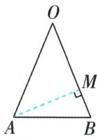

> [!success]- 必刷题
>
> > [!success] **【答案】** $2\sqrt{2}$
>
> > [!note]- **【解析】**
> > 如图, AB 是正八边形的一条边, 点 O 是正八边形的中心, 过点 A 作 $AM \perp OB$ 于 M. 在正八边形中, $\angle AOB = 360^{\circ} \div 8 = 45^{\circ}, \therefore AM = OM. \because OA =$
> >
> > 
> >
> > ## 思路分析
> >
> > OB=1,∴由勾股定理得 $AM=\frac{\sqrt{2}}{2}$ , ∴ $S_{\triangle OAB}=$ $\frac{1}{2}\times OB\times AM=\frac{\sqrt{2}}{4}$ ，∴正八边形面积为 $8\times\frac{\sqrt{2}}{4}=$ $2\sqrt{2},\therefore2\sqrt{2}=1^{2}\times\pi,\therefore\pi=2\sqrt{2},\therefore\pi$ 的估计值为 $2\sqrt{2}$ ，故答案为 $2\sqrt{2}$ .
> >
> > 根据正八边形的性质求出 $\angle AOB = 45^{\circ}$ ，根据勾股定理求出 OB 边上的高 AM 的长，然后求出 $\triangle AOB$ 的面积，进而得到正八边形的面积，再根据等面积法列出等式，即可求得 $\pi$ 的估计值.
