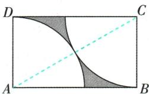
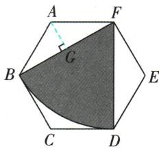

> [!success]- 必刷题
>
> > [!success] **【答案】** D
>
> > [!note]- **【解析】**
> > 如图, 连接 AC. ∵ 两弧有且仅有一个公共点, AD = 4, ∴ AC = 2AD = 8, ∴ 在 Rt△ADC 中, $CD = \sqrt{AC^{2} - AD^{2}} = \sqrt{8^{2} - 4^{2}} = 4\sqrt{3}$ , ∴ $S_{矩形ABCD} = AD \cdot CD = 16\sqrt{3}$ . ∵ $S_{两个扇形} = 2 \times \frac{90 \times \pi \times 4^{2}}{360} = 8\pi$ , ∴ $S_{阴影} = S_{矩形ABCD} - S_{两个扇形} = 16\sqrt{3} - 8\pi$ . 故选 D.
> >
> > 
> >
> > 
> > (第 12 题图)
> > (第 13 题图)
