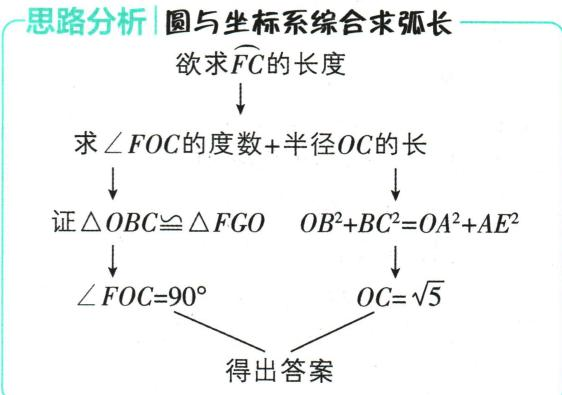

> [!success]- 必刷题
>
> > [!success] **【答案】** A
>
> > [!note]- **【解析】**
> > 
> > 【解析】设点 $A(a,0)$ ，则 $AB = 2 - a$ 。根据题意可得， $OA = OG = a, BC = AB = 2 - a$ 。在 Rt $\triangle OBC$ 中， $OC^2 = OB^2 + BC^2 = 2^2 + (2 - a)^2 = 8 - 4a + a^2$ 。在 Rt $\triangle OAE$ 中， $AE = AG = 2a, OE = OC, OE^2 = OA^2 + AE^2, \therefore 8 - 4a + a^2 = a^2 + (2a)^2$ ，解得 $a = 1$ 或 $a = -2$ （舍去）， $\therefore$ 点 $A(1,0), AB = 1, OC = \sqrt{2^2 + 1^2} = \sqrt{5}$ 。在 $\triangle OBC$ 和 $\triangle FGO$ 中，$\left\{ \begin{array}{l}OB = FG = 2,\\ \angle OBC = \angle FGO = 90^{\circ},\therefore \triangle OBC\cong \triangle FGO(SAS),\\ BC = GO = 1, \end{array} \right.$ ∴∠FOG=∠OCB.∵∠COB+∠OCB=90°，∴∠COB+∠FOG=90°，∴∠FOC=90°，∴弧FC的长为 $\frac{90\pi\times\sqrt{5}}{180} = \frac{\sqrt{5}}{2}\pi .$
> >
> > 故选 **A**.
