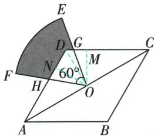

> [!success]- 必刷题
>
> > [!success] **【答案】** A
>
> > [!note]- **【解析】**
> > 0 ^ {\circ}, O D \perp A C, \therefore O M =
> > $$
> >
> > $$
> > O N. \because \angle H O G = 6 0 ^ {\circ}
> > $$
> >
> > 
> >
> > $$
> > \therefore \angle A D C + \angle H O G =
> > $$
> >
> > $180^{\circ}, \therefore \angle NHO + \angle DGO = 180^{\circ}. \because \angle DGO + \angle MGO = 180^{\circ}, \therefore \angle NHO = \angle MGO.$ 在 $\triangle ONH$ 和 $\triangle OMG$ 中， $\left\{ \begin{array}{l} \angle NHO = \angle MGO, \\ \angle ONH = \angle OMG = 90^{\circ}, \\ ON = OM, \end{array} \right.$ $\therefore \triangle ONH \cong \triangle OMG(AAS), \therefore S_{\triangle ONH} = S_{\triangle OMG}, \therefore S_{\text {四边形} HOGD} = S_{\text {四边形} NOMD} = 2S_{\triangle OMD}. \because \angle ODC = 60^{\circ}, \therefore \angle OCD = \angle DOM = 30^{\circ}, \therefore OD = \frac{1}{2} CD = 1, \therefore OC = \sqrt{3} = OA, DM = \frac{1}{2} OD = \frac{1}{2}, \therefore OM = \frac{\sqrt{3}}{2}, \therefore S_{\text {四边形} HOGD} = 2S_{\triangle OMD} = 2 \times \frac{1}{2} \times \frac{1}{2} \times \frac{\sqrt{3}}{2} = \frac{\sqrt{3}}{4}, \therefore S_{\text {阴影部分}} = S_{\text {扇形} OEF} - S_{\text {四边形} HOGD} = \frac{60 \times \pi \times (\sqrt{3})^{2}}{360} - \frac{\sqrt{3}}{4} = \frac{\pi}{2} - \frac{\sqrt{3}}{4}$ ，
> >
> > 故选 **A**.
