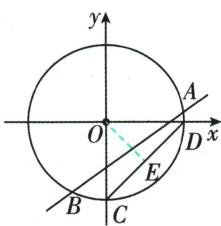

> [!success]- 必刷题
>
> > [!success] **【答案】** B
>
> > [!note]- **【解析】**
> > 如图, 设 $\odot O$ 交 x 轴的正半轴于点▶关键点拨 D, 交 y 轴的负半轴于点 C, 则 $D(4,0)$ , $C(0)$ , 得出直线 y =
> >
> > -4), 连接 $CD$ , 则 $CD = 4\sqrt{2}$ . 过点 $O$ 作 $OE \perp CD$ 于点 $E$ , 则点 $E$ 为 $CD$ 的中点, $\therefore E\left(\frac{0+4}{2}, \frac{-4+0}{2}\right)$ , 即 $E(2,-2)$ . 又 $\because$ 直线
> >
> > 
> >
> > 得出直线 $y = kx - 2(k + 1)$ 经过定点 E(2, -2) 是解题的关键.
> >
> > $y=kx-2(k+1)=(x-2)k-2$ 经过定点 $E(2,-2)$ , $OE \perp CD$ , ∴ 当直线 AB 与直线 CD 重合时, 弦 AB 的长最小, 为 $4\sqrt{2}$ ,
> >
> > 故选 **B**.
