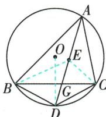

> [!success]- 必刷题
>
> > [!success] **【答案】** D
>
> > [!note]- **【解析】**
> > ∵ 点 E 是 $\triangle ABC$ 的内心, ∴ AD 平分 $\angle BAC$ , ∴ $\angle BAD = \angle CAD$ , 故①正确. 如
> >
> > 图, 连接 BE, CE. ∵ 点 E 是 $\triangle ABC$ 的内心, ∴ $\angle EBC = \frac{1}{2} \angle ABC, \angle ECB = \frac{1}{2} \angle ACB.$ $\because \angle BAC = 60^{\circ}, \therefore \angle ABC +$
> >
> > 
> >
> > $\angle ACB = 120^{\circ}, \therefore \angle BEC = 180^{\circ} - \angle EBC - \angle ECB = 180^{\circ} - \frac{1}{2} (\angle ABC + \angle ACB) = 120^{\circ}$ , 故②正确. 连接 $OD$ . $\because \angle BAD = \angle CAD$ , $\therefore \widehat{BD} = \widehat{DC}, \therefore OD \perp BC$ . $\because$ 点 $G$ 为 $BC$ 的中点, $\therefore$ 点 $G$ 一定为 $OD$ 与 $BC$ 的交点, $\therefore \angle BGD = 90^{\circ}$ , 故③正确. $\because$ 点 $E$ 是 $\triangle ABC$ 的内心, $\therefore BE$ 平分 $\angle ABC$ , $\therefore \angle ABE = \angle CBE$ . $\because \angle DBC = \angle DAC = \angle BAD$ , $\therefore \angle DBC + \angle EBC = \angle EBA + \angle EAB$ , $\therefore \angle DBE = \angle DEB$ , $\therefore DB = DE$ , 故④正确. 综上, 一定正确的是①②③④, 共4个.
> >
> > 故选 **D**.
